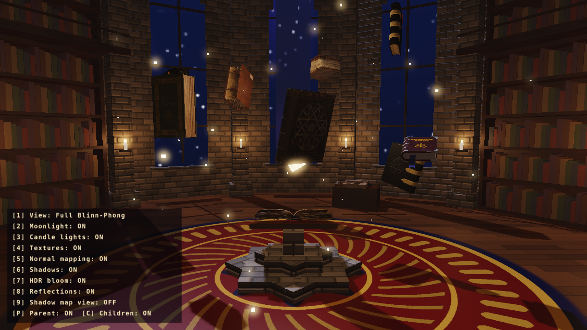
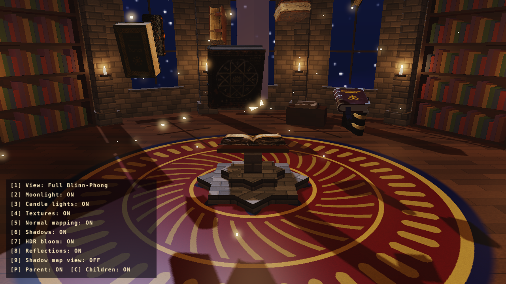
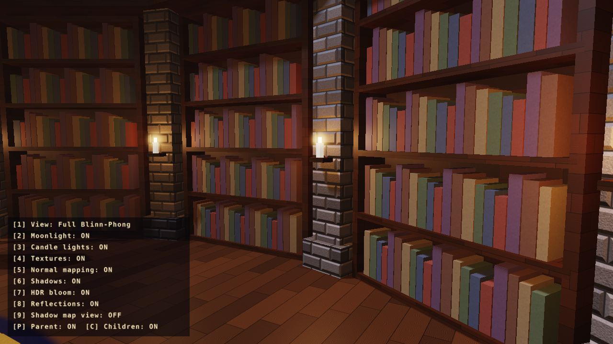
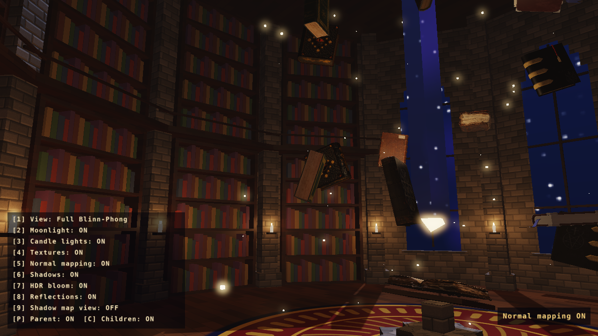
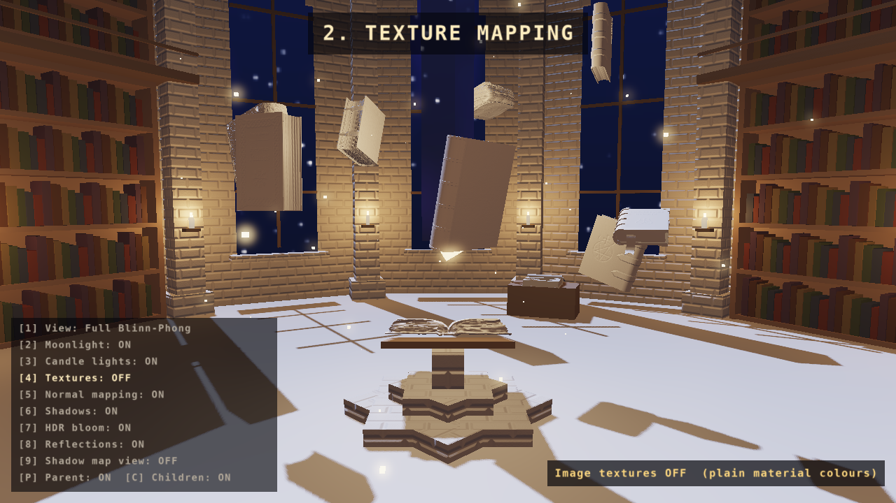

# Library of Floating Books

A real-time OpenGL scene of an impossible library: a round, candle-lit hall where a spiral of old books floats and turns around a glass crystal, under a starry night sky.

Written in C++17 with OpenGL 4.1 Core Profile (macOS).

## Features

**Lighting and shading**
- Blinn-Phong lighting (ambient, diffuse, specular) with 14 lights: a directional moonlight, 12 flickering candle point lights and a magic light that floats with the spiral
- Distance attenuation for point lights
- Phong (per-pixel), Gouraud (per-vertex) and flat (per-face) shading models
- Debug views that isolate the ambient, diffuse and specular terms, and a normals view

**Texture mapping**
- Wood, stone and leather image textures with mipmaps, sRGB handling and tiling
- Planar mapping for the floor, box mapping for the stretched-cube architecture
- A rug decal (one copy of an image, clamped to the edge)
- Each book model's own embedded textures (base colour, normal map, metallic-roughness), loaded straight from the `.glb` file
- Switchable filtering: nearest, bilinear, trilinear mipmaps, trilinear + anisotropic

**Advanced rendering**
- Tangent-space normal mapping (stone walls and book covers)
- Shadow mapping for the moonlight with 5x5 PCF soft edges
- Cubemap night sky seen through the windows and ceiling opening, plus environment reflections on the crystal
- HDR rendering with bloom (bright pass + separable Gaussian blur) and ACES tone mapping with gamma correction
- Parent-child hierarchical animation: the spiral (parent) turns and floats while each book (child) bobs, spins and tilts
- First-person fly camera
- On-screen bitmap-font labels showing every feature switch

| Moonlight shadows | Normal-mapped stone |
|---|---|
|  |  |
| **Crystal reflecting the sky cubemap** | **Textures off: lighting and shadows only** |
|  |  |

## Building (macOS)

Requires CMake, GLFW, GLM and Assimp (for example `brew install cmake glfw glm assimp`).

    cmake -S . -B build
    cmake --build build
    ./build/FloatingLibrary

Run it from the project folder: it loads `shaders/` and `models/` by relative path.

### 3D models
The book models are third-party assets with their own licences, so they are not included in this repository. Place these `.glb` files in `models/`:

| File | Source |
|---|---|
| `book.glb` | [add link] |
| `brimstone_boogie_alchemy_book.glb` | [add link] |
| `devils_bible_-_dark_fantasy_book.glb` | [add link] |
| `old_book.glb` | [add link] |
| `wyrm_hunter_s_guide.glb` | [add link] |
| `de_stirpium.glb` | [add link] |
| `coptic_prayer_book.glb` | [add link] |
| `ancient_book_made_with_ai.glb` | [add link] |
| `book-case.glb` | [add link] |

The wood, stone, leather, rug, sky and font textures in `models/textures/` were generated with `tools/make_textures.py`.

## Controls

| Key | Action |
|---|---|
| W A S D / Q E / Shift | move / down, up / faster |
| Mouse or arrow keys | look around |
| ESC / M | release the mouse (press twice to quit) / capture it again |
| 1 | lighting view: full > ambient > diffuse > specular > normals |
| 2 / 3 | moonlight / candle lights on, off |
| 0 | shading model: Phong > Gouraud > flat |
| 4 | textures on, off |
| F | texture filtering mode |
| 5 / 6 / 7 / 8 | normal mapping / shadows / bloom / reflections |
| 9 | show the shadow map |
| P / C | pause the parent / child animation |
| TAB / H | section title / hide labels |

## Project structure

    src/        C++ modules, one per feature
    shaders/    GLSL: scene, shadow, post-processing, text
    models/     .glb models (not included) and generated textures
    tools/      texture generator script
